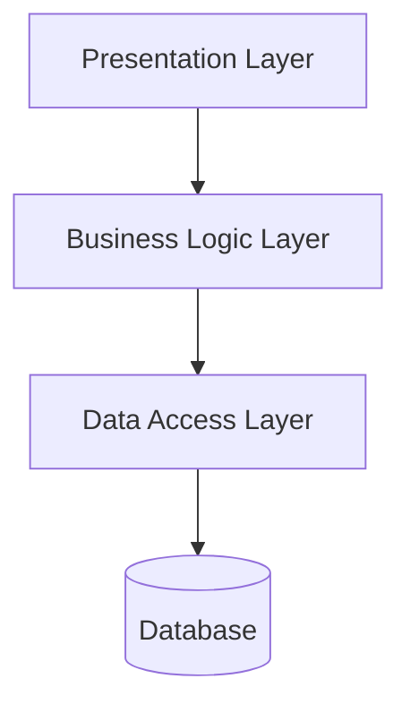
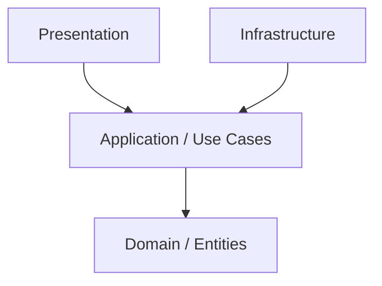
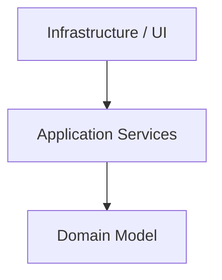
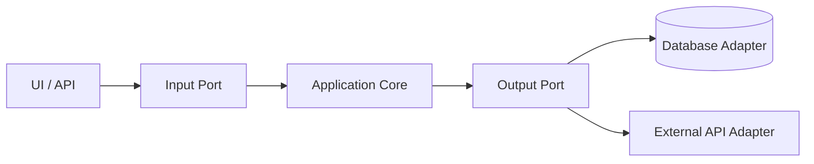
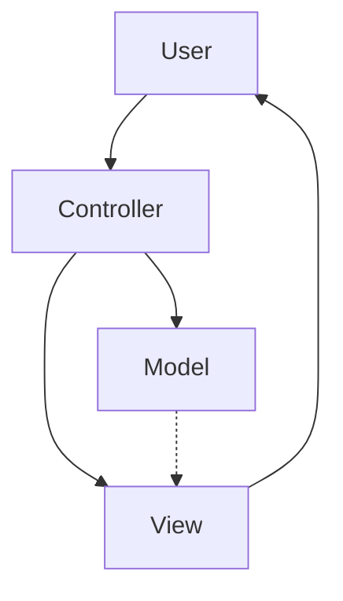
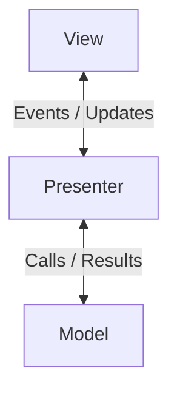
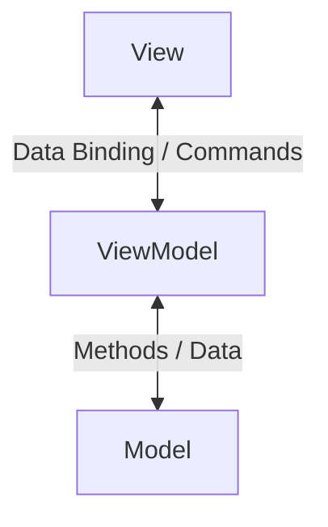
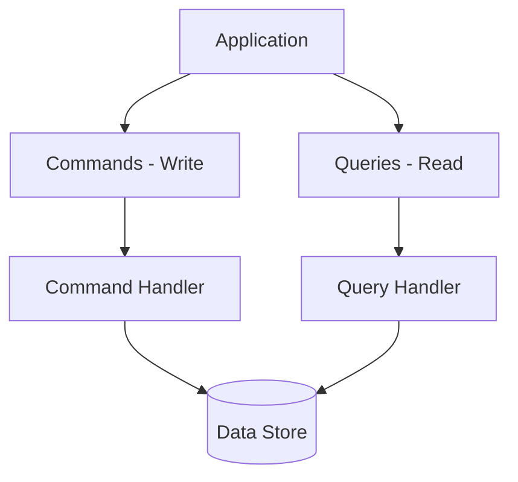
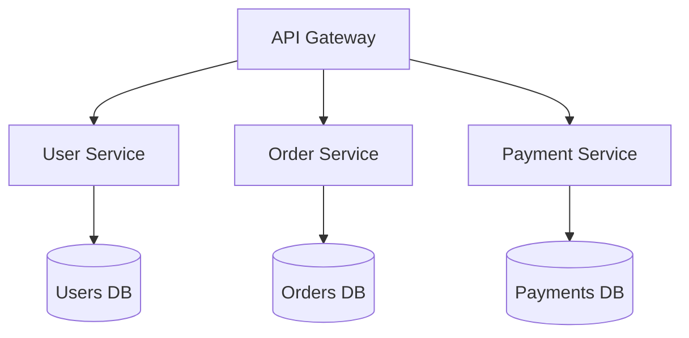
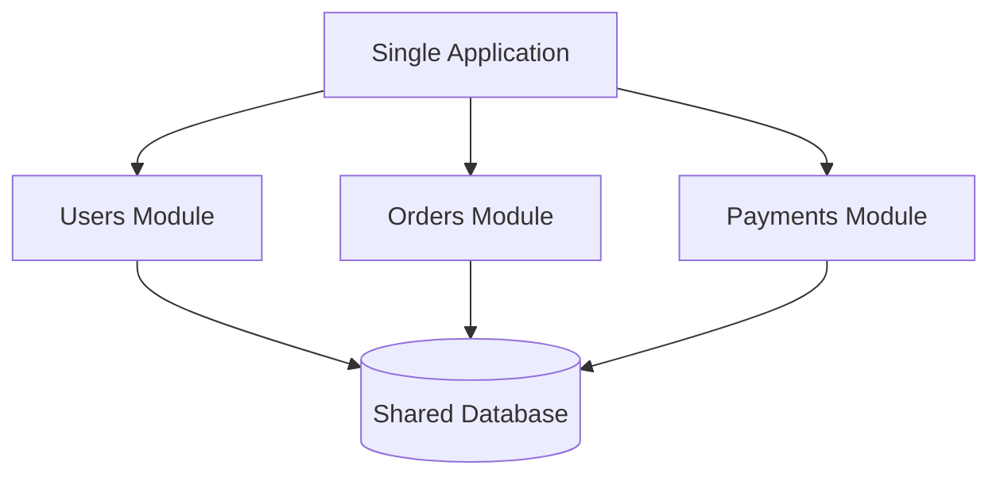

# Αρχιτεκτονική Λογισμικου

Η αρχιτεκτονική λογισμικού (Software Architecture) είναι ο τρόπος με τον οποίο οργανώνουμε τον κώδικα, τις λειτουργίες και τις εξαρτήσεις μιας εφαρμογής.
Τη χρησιμοποιούμε για να γράφουμε προγράμματα που είναι οργανωμένα, επεκτάσιμα, εύκολα στη συντήρηση και στον έλεγχο (testing).
Γιατί χρειαζόμαστε αρχιτεκτονική;
Φαντάσου ότι φτιάχνεις μια εφαρμογή με 100.000 γραμμές κώδικα.
Χωρίς σωστή αρχιτεκτονική, μπορεί να έχεις κώδικα που ανακατεύει βάσεις δεδομένων, ελέγχους, υπολογισμούς και γραφικό περιβάλλον.
Με σωστή αρχιτεκτονική, κάθε τμήμα έχει συγκεκριμένη ευθύνη.
Για παράδειγμα, μπορείς να αλλάξεις τη βάση δεδομένων χωρίς να χρειαστεί να ξαναγράψεις την επιχειρησιακή λογική.

## Γιατί χρειαζόμαστε αρχιτεκτονική;
Φαντάσου ότι φτιάχνεις μια εφαρμογή με 100.000 γραμμές κώδικα.
Χωρίς σωστή αρχιτεκτονική, μπορεί να έχεις κώδικα που ανακατεύει βάσεις δεδομένων, ελέγχους, υπολογισμούς και γραφικό περιβάλλον.
Με σωστή αρχιτεκτονική, κάθε τμήμα έχει συγκεκριμένη ευθύνη.
Για παράδειγμα, μπορείς να αλλάξεις τη βάση δεδομένων χωρίς να χρειαστεί να ξαναγράψεις την επιχειρησιακή λογική.

## Οι βασικές αρχιτεκτονικές λογισμικού

Αρχιτεκτονική|Βασική φιλοσοφία|Επεξησγηση
-------------|----------------|----------
Layered Architecture|Χωρίζει την εφαρμογή σε επίπεδα |Χωρίζει τον κώδικα σε επίπεδα, όπως Presentation, Business Logic και Data Access.Γιατί: Για να διαχωρίζονται οι ευθύνες και να είναι ευκολότερη η συντήρηση.
Clean Architecture|Ανεξαρτησία της επιχειρησιακής λογικής από τις τεχνολογίες|Τοποθετεί την επιχειρησιακή λογική στο κέντρο της εφαρμογής, ανεξάρτητη από βάσεις δεδομένων και UI.Γιατί: Για να μπορείς να αλλάζεις τεχνολογίες χωρίς να επηρεάζεις τους βασικούς κανόνες της εφαρμογής.
Onion Architecture|Οργανώνει τις εξαρτήσεις γύρω από το Domain|Οργανώνει την εφαρμογή σε ομόκεντρα επίπεδα γύρω από το Domain.Γιατί: Για να προστατεύονται οι επιχειρησιακοί κανόνες από εξωτερικές εξαρτήσεις.
Hexagonal Architecture|Επικοινωνία μέσω Ports και Adapters|Η εφαρμογή επικοινωνεί με εξωτερικά συστήματα μέσα από Interfaces και Adapters.Γιατί: Για να αντικαθιστάς εύκολα βάσεις δεδομένων, APIs και άλλες εξωτερικές υπηρεσίες.
MVC|Model, View, Controller|Χωρίζει την εφαρμογή σε δεδομένα/λογική, παρουσίαση και χειρισμό αιτημάτων.Γιατί: Για να οργανώνεται η επικοινωνία μεταξύ χρήστη και εφαρμογής.
MVVM|Model, View, ViewModel|Χωρίζει τη γραφική διεπαφή από τη λογική παρουσίασης μέσω ViewModels.Γιατί: Για να οργανώνεις καλύτερα εφαρμογές WPF και άλλες εφαρμογές με data binding.
MVP|Model, View, Presenter|Χωρίζει την εφαρμογή σε Model (δεδομένα και λογική), View (γραφικό περιβάλλον) και Presenter (συντονισμός της επικοινωνίας μεταξύ View και Model). Γιατί: Για να διαχωρίζεται η λογική παρουσίασης από το γραφικό περιβάλλον, διευκολύνοντας τη συντήρηση και τα Unit Tests.
CQRS|Διαχωρίζει τις εντολές από τα ερωτήματα|Διαχωρίζει τις λειτουργίες που αλλάζουν δεδομένα από εκείνες που τα διαβάζουν.Γιατί: Για να οργανώνεις και να βελτιστοποιείς ανεξάρτητα τις εγγραφές και τις αναζητήσεις.
Microservices|Χωρίζει το σύστημα σε ανεξάρτητες υπηρεσίες|Χωρίζει ένα μεγάλο σύστημα σε μικρές υπηρεσίες που μπορούν να αναπτύσσονται και να εγκαθίστανται ανεξάρτητα.Γιατί: Για ανεξάρτητη ανάπτυξη, εγκατάσταση και κλιμάκωση επιμέρους λειτουργιών.
Modular Monolith|Μία εφαρμογή με ανεξάρτητα οργανωμένα modules|Μία ενιαία εφαρμογή, οργανωμένη σε διακριτά λειτουργικά modules.Γιατί: Για να έχεις καθαρό διαχωρισμό λειτουργιών χωρίς την πολυπλοκότητα των Microservices.

### 1.Layered Architecture

###### Κάθε επίπεδο χρησιμοποιεί το αμέσως κατώτερό του.

### 2. Clean Architecture

###### Οι εξαρτήσεις του κώδικα κατευθύνονται προς τα εσωτερικά επίπεδα.

### 3.Onion Architecture

###### Το Domain βρίσκεται στο κέντρο και δεν εξαρτάται από εξωτερικές τεχνολογίες.

### 4. Hexagonal Architecture

###### Η εφαρμογή επικοινωνεί με εξωτερικά συστήματα μέσω Ports και Adapters.

### 5. MVC — Model View Controller

###### Ο Controller διαχειρίζεται τα αιτήματα, συνεργάζεται με το Model και επιλέγει την κατάλληλη View. Οι λεπτομέρειες διαφέρουν ανά υλοποίηση MVC.
### 6. MVP — Model View Presenter

###### Ο Presenter συντονίζει τη View και το Model.
### 7. MVVM — Model View ViewModel

###### Η View συνδέεται με το ViewModel μέσω Data Binding και Commands.
### 8. CQRS

###### Οι εντολές εγγραφής και τα ερωτήματα ανάγνωσης ακολουθούν ξεχωριστές διαδρομές. Δεν είναι υποχρεωτικό να χρησιμοποιούν διαφορετικές βάσεις δεδομένων.
### 9. Microservices Architecture

###### Κάθε υπηρεσία μπορεί να αναπτύσσεται και να εγκαθίσταται ανεξάρτητα. Το σχέδιο δείχνει μια συνηθισμένη υλοποίηση με ξεχωριστή βάση ανά υπηρεσία.
### 10. Modular Monolith

###### Όλα τα modules αποτελούν μία εφαρμογή, αλλά διατηρούν διακριτές ευθύνες.